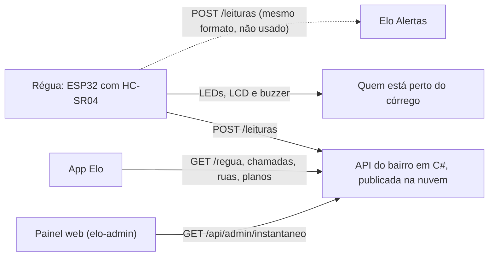
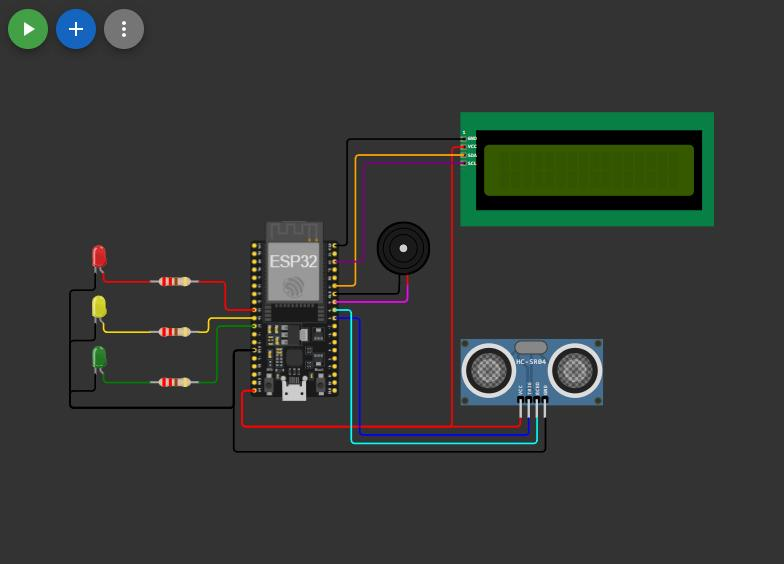

# Elo: régua de nível (ESP32)

Parte de Physical Computing: IoT & IoB do projeto Elo (Global Solution 2026.2, FIAP). O Elo é um app que faz a chamada das ruas de um bairro durante chuva forte. Esta régua é a parte física do projeto: um ESP32 com sensor ultrassônico, instalado acima do córrego, que mede o nível da água e avisa no local quando ele chega ao limite.

**Este é o repositório de IoT do grupo.** Entre os repositórios do grupo, o programa do ESP32 e o circuito ficam só aqui. O `elo-alertas` é outra entrega, a de SOA: um serviço que aceita o mesmo pedido desta régua. Ele não tem código de ESP32.

- **Simulação no Wokwi (pública):** https://wokwi.com/projects/479922926737544193
- **App:** [Elo-Fiap/elo-app](https://github.com/Elo-Fiap/elo-app)
- **API do bairro em C#, que recebe as leituras desta régua e atende o app:** [Elo-Fiap/elo-api-csharp](https://github.com/Elo-Fiap/elo-api-csharp), publicada em http://elo-api-fiap.azurewebsites.net
- **Elo Alertas (entrega de SOA), que aceita o mesmo pedido da régua:** [Elo-Fiap/elo-alertas](https://github.com/Elo-Fiap/elo-alertas)
- **Painel web de administração, que mostra a régua no mapa:** [Elo-Fiap/elo-admin](https://github.com/Elo-Fiap/elo-admin)


## Situação em 18/11/2026

| Item | Situação |
| --- | --- |
| Circuito e programa no Wokwi | Prontos e testados na simulação. Iguais aos deste repositório (conferido em 18/11/2026) |
| Aviso no local (LEDs, LCD e buzzer) | Funciona sem internet |
| Leitura no formato do `POST /leituras` | Aparece no Monitor Serial e é enviada por Wi-Fi |
| Quem recebe a leitura | A API em C#, publicada em http://elo-api-fiap.azurewebsites.net. É dela que o app e o painel leem a régua. O Elo Alertas tem a mesma rota, mas a régua não manda para ele |
| Envio da leitura pela rede | **Ligado à API do grupo e testado** em 18/11/2026: o programa aponta para a API publicada (Azure, plano gratuito), com uma chave de demonstração. 11 envios, todos com resposta 204, entre 1,2 s e 1,7 s, seis deles com o buzzer tocando, e o `GET /regua` devolveu o nível que a régua simulada mandou (0,50 m e depois 1,42 m). A chave vai ser trocada depois da entrega. Veja [Para quem cuida da API](#para-quem-cuida-da-api) |
| App | Já mostra a régua: aviso na aba Agora acima do limite, "em atenção" a partir de 1,00 m, atualização a cada 30 s (10 s acima do limite). Mostra o número da régua quando `EXPO_PUBLIC_API_URL` aponta para a API publicada; sem isso, dado de exemplo |
| Vídeo de até 4 minutos | A gravar. Roteiro em [`roteiro-video.md`](./roteiro-video.md) |
| Entrega no Teams | Até 19/11/2026, 23h55 |

## Onde entra no Elo



As linhas cheias funcionam: a régua manda a leitura para a API em C#, publicada na nuvem em 18/11/2026, e o app e o painel leem dela quando apontam para esse endereço (`EXPO_PUBLIC_API_URL`, no app). A tracejada é o Elo Alertas: aceita o mesmo pedido, mas a régua não manda para ele.

Os dois serviços recebem `POST /leituras` no mesmo formato e com o mesmo header `X-Chave-Dispositivo`. A régua manda para a API em C#, porque é dela que o app e o painel leem (veja os [pontos em aberto](#pontos-em-aberto-para-o-grupo)).

**Onde a régua fica no mapa.** O painel web mostra a régua no mapa do bairro e o gráfico do nível. A posição (latitude e longitude), a rua e os níveis de atenção e de limite ficam no cadastro da régua no servidor, não no programa. O ESP32 continua mandando só `reguaId` e `nivelMetros`. Nos dados de exemplo, a `regua-exemplo` está na Rua das Palafitas, com limite de 1,20 m e atenção em 1,00 m, os mesmos números do `sketch.ino`.

Na aba Plano do app, a rota de saída aparece sob o título "Quando a régua passar de 1,20 m". A régua é esse sinal: a hora de seguir o plano da rua.

## Circuito



| Peça | Ligação | Pino do ESP32 |
| --- | --- | --- |
| Sensor ultrassônico HC-SR04 | TRIG | GPIO 5 |
| | ECHO | GPIO 18 |
| | VCC e GND | 5V e GND |
| Buzzer | positivo | GPIO 19 |
| | negativo | GND |
| LED vermelho (acima do limite) | com resistor de 220 Ω | GPIO 25 |
| LED amarelo (atenção) | com resistor de 220 Ω | GPIO 26 |
| LED verde (normal) | com resistor de 220 Ω | GPIO 27 |
| LCD 16x2 com I2C (endereço 0x27) | SDA | GPIO 21 |
| | SCL | GPIO 22 |
| | VCC e GND | 5V e GND |

A placa é a ESP32 DevKit C v4 do Wokwi. A única biblioteca extra é a `LiquidCrystal I2C`; o Wi-Fi e o HTTP vêm com o ESP32.

No circuito de verdade, o ESP32 trabalha em 3,3 V e não pode receber 5 V. O ECHO do HC-SR04 precisaria de um divisor de tensão, e os fios SDA e SCL do LCD, de um conversor de nível. No simulador não precisa.

## Como a régua se comporta

| Situação | Nível | LED | LCD (linha 2) | Buzzer | Leitura no Monitor Serial |
| --- | --- | --- | --- | --- | --- |
| Normal | abaixo de 1,00 m | verde | `NORMAL` | silêncio | a cada 30 s |
| Atenção | de 1,00 m a 1,19 m | amarelo | `ATENCAO` | um bip curto e grave a cada 1,5 s | a cada 30 s |
| Acima do limite | 1,20 m ou mais | vermelho | `ACIMA DO LIMITE` | bip rápido e agudo (0,2 s tocando, 0,2 s em silêncio) | a cada 10 s |
| Sem leitura | o sensor não respondeu | todos apagados | `SEM LEITURA` | silêncio | nenhuma leitura sai |

- A linha 1 do LCD mostra o nível, com vírgula, como no app: `Nivel: 1,42 m`. No canto direito dela, `*` quer dizer que o último envio pela rede deu certo, e `!`, que falhou.
- Quando a situação muda, a leitura sai na hora, sem esperar o intervalo.
- A regra do limite é a mesma do app: está acima quando o nível é maior ou igual ao limite. Em 1,19 m ainda é atenção; em 1,20 m o alarme dispara.
- O nível de atenção (1,00 m) também está no cadastro da régua na API em C# e no Elo Alertas (`atencaoMetros`). O app mostra "em atenção" no mesmo ponto em que o LED amarelo acende. Se mudar `ATENCAO_CM` no programa, mude também no cadastro.

## Como rodar

1. Abra o [projeto no Wokwi](https://wokwi.com/projects/479922926737544193). Não precisa de conta.
2. Aperte o play. O Wokwi compila o programa antes de rodar; nos testes isso levou de 10 a 40 segundos, e sem login no Wokwi pode haver uma fila de compilação de alguns minutos.
3. Clique no sensor HC-SR04 e mexa no controle "Distance". É a distância do sensor até a água: quanto menor, mais alto o nível.

| Distância no sensor | Nível | O que acontece |
| --- | --- | --- |
| 250 cm | 0,50 m | Normal: LED verde, sem som |
| 200 cm | 1,00 m | Atenção: LED amarelo, um bip a cada 1,5 s |
| 181 cm | 1,19 m | Ainda atenção |
| 180 cm | 1,20 m | Acima do limite: LED vermelho, bip rápido |
| 158 cm | 1,42 m | Acima do limite. É o mesmo número do exemplo do app |

Ao ligar, o ESP32 conecta na rede `Wokwi-GUEST` do simulador (cerca de 2 s) e passa a enviar cada leitura para a API do grupo, publicada em http://elo-api-fiap.azurewebsites.net (o endereço está em `URL_LEITURAS`). O Monitor Serial mostra a leitura no formato que a API recebe e o resultado de cada envio. Saída da simulação em 18/11/2026:

```text
Elo - regua de nivel do corrego
Regua regua-exemplo | sensor a 3,00 m | limite 1,20 m | atencao a partir de 1,00 m
A leitura aparece aqui no formato que a API do Elo recebe (POST /leituras).
Wi-Fi conectado em 1800 ms. Envio das leituras para http://elo-api-fiap.azurewebsites.net/leituras
[   5 s] Situacao: NORMAL | Leitura para POST /leituras: {"reguaId":"regua-exemplo","nivelMetros":0.50}
[   7 s] Envio OK: HTTP 204 em 1657 ms.
[  35 s] Situacao: NORMAL | Leitura para POST /leituras: {"reguaId":"regua-exemplo","nivelMetros":0.50}
[  37 s] Envio OK: HTTP 204 em 1341 ms.
[  75 s] Situacao: ACIMA DO LIMITE | Leitura para POST /leituras: {"reguaId":"regua-exemplo","nivelMetros":1.42}
[  76 s] Envio OK: HTTP 204 em 1206 ms.
[  85 s] Situacao: ACIMA DO LIMITE | Leitura para POST /leituras: {"reguaId":"regua-exemplo","nivelMetros":1.42}
[  86 s] Envio OK: HTTP 204 em 1217 ms.
(...)
[ 132 s] Situacao: ATENCAO | Leitura para POST /leituras: {"reguaId":"regua-exemplo","nivelMetros":1.08}
[ 133 s] Situacao: NORMAL | Leitura para POST /leituras: {"reguaId":"regua-exemplo","nivelMetros":0.50}
[ 133 s] Envio OK: HTTP 204 em 1202 ms.
[ 135 s] Envio OK: HTTP 204 em 1189 ms.
```

Na mesma hora, o `GET /regua` da API passou a devolver `"nivelMetros":1.42` com a hora da medida: é esse número que o app e o painel mostram.

A API fica no plano gratuito do Azure. Parada por um tempo, ela demora até um minuto para acordar, e o primeiro envio pode falhar (`!` no LCD e `Falha no envio` no Serial); o seguinte, 30 s depois, já chega. Para não acontecer na demonstração, abra http://elo-api-fiap.azurewebsites.net/health no navegador antes de apertar o play e espere a resposta.

Para montar em um projeto novo do Wokwi: crie um projeto de ESP32, cole o `sketch.ino` e o `diagram.json` e, na aba "Library Manager", adicione a biblioteca `LiquidCrystal I2C`.

O `sketch.ino` e o `diagram.json` deste repositório são iguais aos do projeto salvo no Wokwi (conferido em 18/11/2026). O Wokwi não sincroniza com o GitHub: quem mudar um lado precisa copiar para o outro.

## Como o programa funciona

1. **Leitura.** A cada 200 ms o ESP32 dispara o HC-SR04 e mede o tempo do eco. Distância em centímetros = tempo em microssegundos × 0,034 ÷ 2.
2. **Medida.** A cada 5 leituras (1 segundo), o programa fica com a do meio, a mediana. Assim, uma leitura fora da curva não estraga a medida.
3. **Nível.** Nível = 300 cm (altura do sensor) menos a distância. Fica em centímetros inteiros; se der menos que zero, conta como zero.
4. **Situação.** 120 cm ou mais: acima do limite. De 100 a 119 cm: atenção. Menos que isso: normal. Se nenhuma das 5 leituras voltou: sem leitura.
5. **Aviso no local.** Os LEDs e o LCD mudam a cada medida. O buzzer é conferido a todo instante, sem `delay`, para o resto do programa não parar.
6. **Leitura para a API.** O programa monta o texto do `POST /leituras` e mostra no Monitor Serial: na hora em que a situação muda e, depois, a cada 30 s (10 s acima do limite).
7. **Envio pela rede.** A leitura entra em uma fila, e uma tarefa separada, no outro núcleo do ESP32, faz o `POST` com o header `X-Chave-Dispositivo`. Assim um envio demorado não para o sensor, os LEDs nem o buzzer. Qualquer resposta 2xx é sucesso (`*` no LCD); recusa, falta de rede ou 8 s sem resposta é falha (`!` no LCD), com o motivo no Serial. A régua não repete o envio: a próxima leitura já sai no intervalo. Com `URL_LEITURAS` vazia, o envio fica desligado.

Os ajustes ficam no começo do `sketch.ino`: `REGUA_ID`, `ALTURA_SENSOR_CM`, `LIMITE_CM`, `ATENCAO_CM`, os intervalos e, para a rede, `WIFI_REDE`, `URL_LEITURAS` e `CHAVE_DISPOSITIVO`. A altura, o limite e o nível de atenção são valores de exemplo. Dois cuidados ao mudar: o `REGUA_ID` cabe até 30 caracteres no texto da leitura; e, fora do simulador, além de trocar `WIFI_REDE` e `WIFI_SENHA` pela rede do local, tire o canal `6` do `WiFi.begin`, que só serve para conectar mais rápido no Wokwi.

## Arquivos

| Arquivo | O que é |
| --- | --- |
| `sketch.ino` | Programa do ESP32 (Arduino) |
| `diagram.json` | Circuito do Wokwi: peças e fios |
| `libraries.txt` | Biblioteca usada |
| `roteiro-video.md` | Roteiro do vídeo de até 4 minutos e conferência da entrega |
| `integrantes.txt` | Nome e RM dos integrantes; vai na entrega do Teams |
| `prompts.md` | Registro do uso de IA |
| `docs/` | Imagens deste README |

## Para quem cuida da API

### Resumo

- A régua monta a leitura no formato do contrato do app (`docs/contrato-api.md` do `elo-app`, seção "O que o ESP32 envia").
- Dois serviços do grupo recebem essa leitura (`POST /leituras`) e respondem a consulta (`GET /regua`), no mesmo formato: a API em C# (`elo-api-csharp`, desde 10/11/2026) e o Elo Alertas (`elo-alertas`, desde 06/11/2026). Eles não trocam dados entre si.
- O app e o painel web leem a régua da API em C#. Por isso a régua manda para ela.
- A régua **já envia para a API publicada**: Wi-Fi do Wokwi e `POST /leituras` por HTTP simples para `http://elo-api-fiap.azurewebsites.net/leituras`, testado em 18/11/2026 (11 envios, todos `204`). O endereço e a chave são duas constantes no começo do programa, `URL_LEITURAS` e `CHAVE_DISPOSITIVO`. A chave é só de demonstração, combinada com o grupo, e vai ser trocada depois da entrega.

### O pedido que a régua envia

```http
POST /leituras
Content-Type: application/json
X-Chave-Dispositivo: <chave da régua>

{"reguaId":"regua-exemplo","nivelMetros":1.42}
```

| Campo | Valor | Observação |
| --- | --- | --- |
| `reguaId` | `"regua-exemplo"` | Fixo no programa (`REGUA_ID`) |
| `nivelMetros` | número, de `0.00` a `2.98` na simulação | Sempre com ponto e 2 casas: `0.50`, `1.20`, `1.42`. Nunca negativo, nunca `null` |
| `medidaEm` | não vai | O ESP32 do Wokwi não tem relógio. Vale a hora em que o servidor recebe. O app compara essa hora com o relógio do celular (mais de 5 minutos atrás vira "leitura antiga"; mais de 2 minutos adiantada, "hora não confere"), então o relógio do servidor precisa estar certo |
| `bateriaPercentual` | não vai | A régua simulada não tem bateria |

Quando a leitura sai:

- na hora em que a situação muda (normal, atenção, acima do limite);
- a cada 30 s, enquanto a situação é normal ou atenção;
- a cada 10 s, enquanto está acima do limite;
- nunca, enquanto o sensor não responde.

Resposta esperada: `204`, sem corpo. O programa trata qualquer 2xx como sucesso. Outra resposta (por exemplo `401`, chave errada), ou nenhuma resposta em 8 s, conta como falha: aparece no Monitor Serial e vira `!` no LCD. A régua não repete o envio, porque a próxima leitura já sai no intervalo.

Em um teste durante a montagem, o ESP32 simulado mandou esse pedido a um serviço público de eco (httpbin.org), que devolveu o que recebeu:

```text
POST
Content-Type: application/json
Content-Length: 46
User-Agent: ESP32HTTPClient
Accept-Encoding: identity;q=1,chunked;q=0.1,*;q=0
X-Chave-Dispositivo: <texto de teste>

{"reguaId":"regua-exemplo","nivelMetros":0.50}
```

A chave desse teste era um texto inventado. Hoje o `sketch.ino` entregue faz esse mesmo pedido, por HTTP simples, para a API publicada, com a chave de demonstração combinada com o grupo.

### Conferência com o Elo Alertas

| Item | Régua | Elo Alertas | Confere? |
| --- | --- | --- | --- |
| Rota | `POST /leituras` | `POST /leituras` | Sim |
| Tipo do corpo | `application/json` | JSON | Sim |
| Header da chave | `X-Chave-Dispositivo` | `x-chave-dispositivo` | Sim. Nome de header não diferencia maiúscula de minúscula |
| Id da régua | `regua-exemplo` | `regua-exemplo`, criada pelo seed | Sim |
| `nivelMetros` | número com 2 casas, de 0.00 a 2.98 | número de 0 a 20; mais de 2 casas são arredondadas | Sim |
| Campos opcionais | não envia | `medidaEm` e `bateriaPercentual` são opcionais | Sim |
| Altura do sensor | 3,00 m (`ALTURA_SENSOR_CM = 300`) | `alturaSensorMetros: 3.0` no seed | Sim |
| Limite | 1,20 m (`LIMITE_CM = 120`), usado só no aviso local | `limiteMetros: 1.2` no seed | Sim, mas está em dois lugares |
| Regra do limite | nível maior ou igual ao limite | `nivelMetros >= limiteMetros` | Sim |
| Intervalos | 30 s; 10 s acima do limite; mais uma leitura quando a situação muda | 30 s; 10 s acima do limite | Sim. A leitura extra não está no contrato |
| Resposta de sucesso | espera `204` | devolve `204` | Sim |
| Sensor sem resposta | não envia nada | recusa `nivelMetros: null` com `400` | Sim |

Essa conferência foi feita lendo o código do Elo Alertas no commit `36879b5`. O Elo Alertas tem um teste de integração com um corpo igual ao da régua, só com `reguaId` e `nivelMetros` (`test/integracao/sensor.test.ts`), e a evidência dele mostra os testes passando.

**A régua nunca enviou uma leitura de verdade ao Elo Alertas.** Isso só dá para testar com o serviço em um endereço que a régua alcance.

### Conferência com a API em C#

| Item | Régua | API em C# | Confere? |
| --- | --- | --- | --- |
| Rota | `POST /leituras` | `POST /leituras`, sem o prefixo `/api` | Sim |
| Header da chave | `X-Chave-Dispositivo` | `X-Chave-Dispositivo`, conferido antes de ler o corpo; sem chave ou com chave errada, `401` | Sim |
| Chave | chave de demonstração em `CHAVE_DISPOSITIVO`, visível no projeto público, trocada depois da entrega | uma chave para todos os dispositivos, na variável `Dispositivos__Chave`. Sem chave configurada, só o modo de desenvolvimento aceita a leitura | Sim. No Azure a chave está configurada e é igual à do programa |
| Id da régua | `regua-exemplo` | `regua-exemplo`, criada pela semente; até 40 caracteres, sem diferenciar maiúsculas | Sim |
| `nivelMetros` | número com 2 casas, de 0.00 a 2.98 | número de 0 a 5 m, guardado em centímetros | Sim |
| Campos opcionais | não envia | `medidaEm` opcional (vale a hora do servidor); `bateriaPercentual` aceito e não guardado | Sim |
| Limite e atenção | 1,20 m e 1,00 m | 120 cm e 100 cm na `regua-exemplo`, devolvidos no `GET /regua` como `limiteMetros` e `atencaoMetros` | Sim, em mais de um lugar |
| Regra do limite | nível maior ou igual ao limite | `nivelCm >= limiteCm` | Sim |
| Resposta de sucesso | espera `204` | `204`, sem corpo | Sim |
| Qual régua o app vê | `regua-exemplo` | `ContratoDoApp:ReguaPadrao`, que é `regua-exemplo` | Sim |
| HTTP simples | recomendado para o ESP32 | HTTP simples, sem redirecionar para HTTPS: no Azure o "HTTPS Only" fica desligado; localmente, porta 5080 | Sim. Testado de fora e da régua simulada em 18/11/2026 |

Essa conferência foi feita lendo o código da API em C# no commit `0020934` (15/11/2026). A evidência `docs/evidencias/fluxo-completo.md` dela mostra o mesmo corpo da régua recebendo `401` sem a chave e `204` com a chave.

Em 18/11/2026 a conferência deixou de ser só leitura: a régua simulada enviou 11 leituras à API publicada, todas com `204`, e o `GET /regua` devolveu os mesmos números (veja [O que foi testado](#o-que-foi-testado)).

### Como está ligado

Do lado de quem recebe a leitura:

1. **Endereço público.** A API em C# está publicada no Azure (App Service, plano gratuito), em HTTP simples: http://elo-api-fiap.azurewebsites.net. O `/health` responde 200; o `POST /leituras` responde 401 sem a chave e 204 com ela; a página inicial do endereço mostra a última leitura da régua. O ESP32 simulado no Wokwi só alcança endereços da internet, então o `localhost` de quem desenvolve nunca serviu.
2. **Chave de demonstração.** A chave em `CHAVE_DISPOSITIVO` no `sketch.ino` é igual à `Dispositivos__Chave` da API. Ela fica visível no projeto público do Wokwi e neste repositório, de propósito: é só para a demonstração e vai ser trocada depois da entrega, nos dois lugares ao mesmo tempo (se mudar só na API, a régua passa a receber 401 e mostra `!`). Não deixar a API em modo de desenvolvimento sem chave: nesse modo ela aceita leitura sem o header.
3. **HTTP simples.** No teste de 06/11/2026, o envio por HTTPS levou de 6,5 a 7,7 segundos no ESP32 simulado e falhou todas as vezes em que o buzzer tocava. Por HTTP simples, os envios levam de 1 a 2 s e não falham com o buzzer. A API aceita HTTP e não redireciona para HTTPS, que é o que a régua precisa; a opção "HTTPS Only" do App Service precisa continuar desligada. Render, Railway, Vercel e similares redirecionam tudo para HTTPS e por isso não foram usados.
4. **Acordar a API.** No plano gratuito, a API dorme depois de um tempo parada e demora até um minuto para responder de novo. O envio da régua espera até 8 s; se a API estiver dormindo, o primeiro envio falha e o seguinte chega. Antes de uma demonstração, abra http://elo-api-fiap.azurewebsites.net/health no navegador.

Do lado da régua, para trocar o servidor ou a chave:

1. No começo do `sketch.ino`, trocar `URL_LEITURAS` e `CHAVE_DISPOSITIVO`.
2. Salvar o projeto no Wokwi e copiar o mesmo `sketch.ino` para este repositório.
3. Testar na simulação: `Envio OK: HTTP 204` no Monitor Serial e o mesmo número no `GET /regua`, na página inicial do endereço, no app e no painel.

As tarefas dos dois lados estão na [issue 4 do `elo-app`](https://github.com/Elo-Fiap/elo-app/issues/4).

### Como testar a rota sem a régua

Este pedido é igual ao que a régua manda. Na API publicada:

```bash
curl -i -X POST http://elo-api-fiap.azurewebsites.net/leituras \
  -H 'Content-Type: application/json' \
  -H 'X-Chave-Dispositivo: <a chave que está em CHAVE_DISPOSITIVO no sketch.ino>' \
  -d '{"reguaId":"regua-exemplo","nivelMetros":1.42}'
```

A resposta deve ser `204`, sem corpo; sem o header, `401`. Na API rodando no computador (`dotnet run --project src/Elo.Api`, porta 5080), troque o endereço por `http://localhost:5080`; em desenvolvimento, sem `Dispositivos__Chave`, ela aceita sem o header. No Elo Alertas (porta 3040), o mesmo pedido, com a chave do `.env` dele. Depois:

```bash
curl -i "http://elo-api-fiap.azurewebsites.net/regua"
```

A resposta deve trazer `"nivelMetros":1.42`, `"limiteMetros":1.2`, `"atencaoMetros":1` e a hora da medida em `medidaEm`. Com esses números, a aba Bairro do app mostra "1,42 m, limite 1,20 m, acima do limite", e a aba Agora mostra o aviso "Régua acima do limite". Esse pedido muda o que todo mundo vê na API publicada; depois do teste, mande uma leitura normal (por exemplo `0.50`) ou deixe a régua simulada rodando.

## Pontos em aberto para o grupo

1. **Quem recebe a leitura.** O app usa um endereço só (`EXPO_PUBLIC_API_URL`) para `/situacao`, `/chamadas`, `/regua` e `/ruas/{id}/plano`, e esse endereço é a API em C#. A régua manda para ela, publicada em http://elo-api-fiap.azurewebsites.net. O Elo Alertas tem as mesmas duas rotas, mas não recebe nada da régua, e os dois serviços não trocam dados. Para o app e o painel mostrarem o número da régua, eles precisam apontar para esse mesmo endereço.
2. **Uma régua só.** O app chama `GET /regua` sem dizer qual régua. A API em C# responde com a régua configurada em `ContratoDoApp:ReguaPadrao`, e o Elo Alertas, com a primeira por ordem de id. Com uma régua, funciona.
3. **Chave em projeto público.** A chave de demonstração em `CHAVE_DISPOSITIVO` fica visível para quem abrir o Wokwi ou este repositório, e vale na API publicada: até ser trocada, qualquer pessoa com ela consegue mandar leituras. Depois da entrega, trocar `Dispositivos__Chave` na API e a constante no programa ao mesmo tempo; veja "Como está ligado".
4. **Leitura extra quando a situação muda.** Não está no contrato. Se o nível ficar oscilando em volta de 1,00 m ou de 1,20 m, a régua pode publicar até uma leitura por segundo. Se isso atrapalhar o servidor, dá para limitar no programa.
5. **Régua sem leitura.** Quando o sensor não responde, a régua não envia nada. O servidor e o app continuam com a última leitura e a hora dela. O contrato não tem um jeito de dizer "régua sem leitura".
6. **Limite em mais de um lugar.** O 1,20 m está no programa da régua, para o buzzer funcionar sem internet, e no cadastro da régua no servidor (Elo Alertas e API em C#), de onde o app e o painel leem. Se mudar em um, precisa mudar nos outros.
7. **Nível de atenção.** O 1,00 m estava só na régua. Agora também fica no cadastro da régua nos dois serviços (`atencaoMetros`), para o app e o painel mostrarem "atenção" no mesmo ponto em que o LED amarelo acende. A mesma regra do limite vale aqui: se mudar no programa, mude no cadastro.
8. **README do app.** A tabela "De onde vêm os dados" colocava a régua na API do bairro e dizia que essa API não existia. A API em C# existe e também recebe e devolve a leitura da régua. O README do app já foi corrigido.

## O que foi testado

Tudo na simulação do Wokwi. Este repositório não tem teste automático.

- Níveis de 0,00 m a 2,98 m, com a virada exata em 1,20 m (1,19 m ainda é atenção).
- LEDs, LCD, ritmo do buzzer e a leitura no Monitor Serial em cada situação.
- Intervalos de 30 s e de 10 s, e a leitura na hora em que a situação muda.
- Sensor sem resposta: o LCD mostra `SEM LEITURA` e nenhuma leitura sai.
- Em 09/11/2026, o projeto público foi rodado de novo: 0,50 m em situação normal e 1,42 m acima do limite. A primeira imagem deste README é desse teste.
- Em 15/11/2026, o envio pela rede: Wi-Fi do Wokwi conectado em 1,9 s; 12 envios para um serviço público de eco (`http://httpbin.org/post`) por HTTP simples, todos com resposta 200, entre 0,93 s e 1,2 s; seis deles com o buzzer tocando acima do limite; a leitura extra em cada mudança de situação (normal, acima do limite, atenção, normal) e os intervalos de 30 s e 10 s mantidos durante os envios.
- Em 18/11/2026, o envio para a API publicada (`http://elo-api-fiap.azurewebsites.net/leituras`): Wi-Fi conectado em 1,8 s; 11 envios, todos com resposta 204, entre 1,19 s e 1,72 s; seis deles com o buzzer tocando acima do limite; a leitura extra em cada mudança de situação (normal, acima do limite, atenção, normal), inclusive duas leituras com um segundo de diferença, as duas enviadas pela fila; e o `GET /regua` devolvendo o nível da régua simulada (0,50 m e, depois, 1,42 m) com a hora da medida, poucos segundos depois de cada envio.

Não foi testado: a falha de rede (endereço fora do ar), a API acordando do plano gratuito no meio da simulação e o envio para o Elo Alertas (a régua não manda para ele). O app e o painel mostrando a leitura enviada não foram conferidos a partir deste repositório.

## Entrega no Teams

Um integrante só envia, até 19/11/2026, 23h55:

- [ ] Link público do projeto no Wokwi: https://wokwi.com/projects/479922926737544193
- [ ] Link do vídeo, com até 4 minutos
- [ ] Arquivo [`integrantes.txt`](./integrantes.txt)

## Uso de IA

O programa, o circuito, o roteiro do vídeo e este README foram gerados com Claude Code, a partir dos pedidos do Bruno, e testados na simulação. O registro, o que a IA decidiu sozinha, os erros que ela cometeu e o que a equipe precisa conferir estão em [`prompts.md`](./prompts.md). Todos os integrantes precisam saber explicar cada linha do `sketch.ino`.

## Integrantes

Nome e RM de todos em [`integrantes.txt`](./integrantes.txt).
