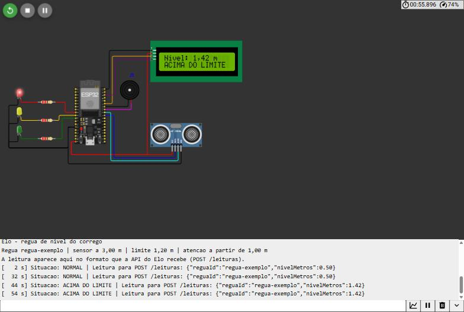
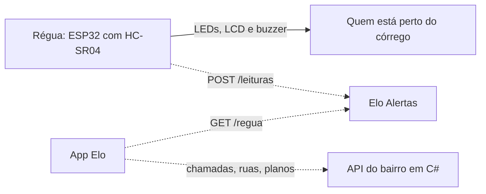

# Elo: régua de nível (ESP32)

Parte de Physical Computing: IoT & IoB do projeto Elo (Global Solution 2026.2, FIAP). O Elo é um app que faz a chamada das ruas de um bairro durante chuva forte. Esta régua é a parte física do projeto: um ESP32 com sensor ultrassônico, instalado acima do córrego, que mede o nível da água e avisa no local quando ele chega ao limite.

- **Simulação no Wokwi (pública):** https://wokwi.com/projects/479922926737544193
- **App:** [Elo-Fiap/elo-app](https://github.com/Elo-Fiap/elo-app)
- **Serviço que recebe as leituras:** [Elo-Fiap/elo-alertas](https://github.com/Elo-Fiap/elo-alertas)



## Situação em 09/11/2026

| Item | Situação |
| --- | --- |
| Circuito e programa no Wokwi | Prontos e testados na simulação |
| Aviso no local (LEDs, LCD e buzzer) | Funciona sem internet |
| Leitura no formato do `POST /leituras` | Aparece no Monitor Serial |
| Envio da leitura pela rede | **Não feito.** Falta um endereço público para quem recebe. Veja [Para quem cuida da API](#para-quem-cuida-da-api) |
| Vídeo de até 4 minutos | A gravar. Roteiro em [`roteiro-video.md`](./roteiro-video.md) |
| Entrega no Teams | Até 19/11/2026, 23h55 |

## Onde entra no Elo



A linha cheia já funciona. As tracejadas ainda não estão ligadas: hoje o app mostra dados de exemplo e a régua mostra a leitura só no Monitor Serial.

O desenho segue o README do Elo Alertas. O app ainda usa um endereço só para tudo; veja os [pontos em aberto](#pontos-em-aberto-para-o-grupo).

Na aba Plano do app, a rota de saída aparece sob o título "Quando a régua passar de 1,20 m". A régua é esse sinal: a hora de seguir o plano da rua.

## Circuito


| Peça | Ligação | Pino do ESP32 |
| --- | --- | --- |
| Sensor ultrassônico HC-SR04 | TRIG | GPIO 5 |
| | ECHO | GPIO 18 |
| | VCC e GND | 5V e GND |
| Buzzer | positivo | GPIO 19 |
| | negativo | GND |
| LED vermelho (acima do limite) | com resistor de 220 Ω | GPIO 25 |
| LED amarelo (atenção) | com resistor de 220 Ω | GPIO 26 |
| LED verde (normal) | com resistor de 220 Ω | GPIO 27 |
| LCD 16x2 com I2C (endereço 0x27) | SDA | GPIO 21 |
| | SCL | GPIO 22 |
| | VCC e GND | 5V e GND |

A placa é a ESP32 DevKit C v4 do Wokwi. A única biblioteca é a `LiquidCrystal I2C`.

No circuito de verdade, o ESP32 trabalha em 3,3 V e não pode receber 5 V. O ECHO do HC-SR04 precisaria de um divisor de tensão, e os fios SDA e SCL do LCD, de um conversor de nível. No simulador não precisa.

## Como a régua se comporta

| Situação | Nível | LED | LCD (linha 2) | Buzzer | Leitura no Monitor Serial |
| --- | --- | --- | --- | --- | --- |
| Normal | abaixo de 1,00 m | verde | `NORMAL` | silêncio | a cada 30 s |
| Atenção | de 1,00 m a 1,19 m | amarelo | `ATENCAO` | um bip curto e grave a cada 1,5 s | a cada 30 s |
| Acima do limite | 1,20 m ou mais | vermelho | `ACIMA DO LIMITE` | bip rápido e agudo (0,2 s tocando, 0,2 s em silêncio) | a cada 10 s |
| Sem leitura | o sensor não respondeu | todos apagados | `SEM LEITURA` | silêncio | nenhuma leitura sai |

- A linha 1 do LCD mostra o nível, com vírgula, como no app: `Nivel: 1,42 m`.
- Quando a situação muda, a leitura sai na hora, sem esperar o intervalo.
- A regra do limite é a mesma do app: está acima quando o nível é maior ou igual ao limite. Em 1,19 m ainda é atenção; em 1,20 m o alarme dispara.
- O nível de atenção (1,00 m) existe só na régua. O app e o Elo Alertas conhecem apenas o limite.

## Como rodar

1. Abra o [projeto no Wokwi](https://wokwi.com/projects/479922926737544193). Não precisa de conta.
2. Aperte o play. O Wokwi compila o programa antes de rodar; nos testes isso levou de 10 a 40 segundos.
3. Clique no sensor HC-SR04 e mexa no controle "Distance". É a distância do sensor até a água: quanto menor, mais alto o nível.

| Distância no sensor | Nível | O que acontece |
| --- | --- | --- |
| 250 cm | 0,50 m | Normal: LED verde, sem som |
| 200 cm | 1,00 m | Atenção: LED amarelo, um bip a cada 1,5 s |
| 181 cm | 1,19 m | Ainda atenção |
| 180 cm | 1,20 m | Acima do limite: LED vermelho, bip rápido |
| 158 cm | 1,42 m | Acima do limite. É o mesmo número do exemplo do app |

O Monitor Serial mostra a leitura no formato que a API recebe. Saída da simulação em 09/11/2026:

```text
Elo - regua de nivel do corrego
Regua regua-exemplo | sensor a 3,00 m | limite 1,20 m | atencao a partir de 1,00 m
A leitura aparece aqui no formato que a API do Elo recebe (POST /leituras).
[   2 s] Situacao: NORMAL | Leitura para POST /leituras: {"reguaId":"regua-exemplo","nivelMetros":0.50}
[  32 s] Situacao: NORMAL | Leitura para POST /leituras: {"reguaId":"regua-exemplo","nivelMetros":0.50}
[  44 s] Situacao: ACIMA DO LIMITE | Leitura para POST /leituras: {"reguaId":"regua-exemplo","nivelMetros":1.42}
[  54 s] Situacao: ACIMA DO LIMITE | Leitura para POST /leituras: {"reguaId":"regua-exemplo","nivelMetros":1.42}
```

Para montar em um projeto novo do Wokwi: crie um projeto de ESP32, cole o `sketch.ino` e o `diagram.json` e, na aba "Library Manager", adicione a biblioteca `LiquidCrystal I2C`.

O `sketch.ino` e o `diagram.json` deste repositório são iguais aos do projeto salvo no Wokwi (conferido em 09/11/2026). O Wokwi não sincroniza com o GitHub: quem mudar um lado precisa copiar para o outro.

## Como o programa funciona

1. **Leitura.** A cada 200 ms o ESP32 dispara o HC-SR04 e mede o tempo do eco. Distância em centímetros = tempo em microssegundos × 0,034 ÷ 2.
2. **Medida.** A cada 5 leituras (1 segundo), o programa fica com a do meio, a mediana. Assim, uma leitura fora da curva não estraga a medida.
3. **Nível.** Nível = 300 cm (altura do sensor) menos a distância. Fica em centímetros inteiros; se der menos que zero, conta como zero.
4. **Situação.** 120 cm ou mais: acima do limite. De 100 a 119 cm: atenção. Menos que isso: normal. Se nenhuma das 5 leituras voltou: sem leitura.
5. **Aviso no local.** Os LEDs e o LCD mudam a cada medida. O buzzer é conferido a todo instante, sem `delay`, para o resto do programa não parar.
6. **Leitura para a API.** O programa monta o texto do `POST /leituras` e mostra no Monitor Serial: na hora em que a situação muda e, depois, a cada 30 s (10 s acima do limite).

Os ajustes ficam no começo do `sketch.ino`: `REGUA_ID`, `ALTURA_SENSOR_CM`, `LIMITE_CM`, `ATENCAO_CM` e os intervalos. A altura, o limite e o nível de atenção são valores de exemplo.

## Arquivos

| Arquivo | O que é |
| --- | --- |
| `sketch.ino` | Programa do ESP32 (Arduino) |
| `diagram.json` | Circuito do Wokwi: peças e fios |
| `libraries.txt` | Biblioteca usada |
| `roteiro-video.md` | Roteiro do vídeo de até 4 minutos e conferência da entrega |
| `integrantes.txt` | Nome e RM dos integrantes; vai na entrega do Teams |
| `prompts.md` | Registro do uso de IA |
| `docs/` | Imagens deste README |

## Para quem cuida da API

### Resumo

- A régua monta a leitura no formato do contrato do app (`docs/contrato-api.md` do `elo-app`, seção "O que o ESP32 envia").
- O Elo Alertas já tem a rota que recebe essa leitura (`POST /leituras`) e a que o app lê (`GET /regua`), desde 06/11/2026.
- A régua **ainda não envia nada pela rede**. Faltam um endereço público e uma chave de demonstração.
- Se o grupo decidir que quem recebe a leitura é a API em C#, o pedido da régua é o mesmo.

### O pedido que a régua vai enviar

```http
POST /leituras
Content-Type: application/json
X-Chave-Dispositivo: <chave da régua>

{"reguaId":"regua-exemplo","nivelMetros":1.42}
```

| Campo | Valor | Observação |
| --- | --- | --- |
| `reguaId` | `"regua-exemplo"` | Fixo no programa (`REGUA_ID`) |
| `nivelMetros` | número, de `0.00` a `2.98` na simulação | Sempre com ponto e 2 casas: `0.50`, `1.20`, `1.42`. Nunca negativo, nunca `null` |
| `medidaEm` | não vai | O ESP32 não tem relógio. Vale a hora em que o servidor recebe |
| `bateriaPercentual` | não vai | A régua simulada não tem bateria |

Quando a leitura sai:

- na hora em que a situação muda (normal, atenção, acima do limite);
- a cada 30 s, enquanto a situação é normal ou atenção;
- a cada 10 s, enquanto está acima do limite;
- nunca, enquanto o sensor não responde.

Resposta esperada: `204`, sem corpo. O programa ainda não trata a resposta, porque ainda não envia. A proposta é simples: `204` é sucesso; qualquer outra resposta é falha, e a régua não repete o envio, porque a próxima leitura já sai no intervalo.

Em um teste durante a montagem, o ESP32 simulado mandou esse pedido a um serviço público de eco (httpbin.org), que devolveu o que recebeu:

```text
POST
Content-Type: application/json
Content-Length: 46
User-Agent: ESP32HTTPClient
Accept-Encoding: identity;q=1,chunked;q=0.1,*;q=0
X-Chave-Dispositivo: <texto de teste>

{"reguaId":"regua-exemplo","nivelMetros":0.50}
```

A chave desse teste era um texto inventado. O código do teste não está no `sketch.ino` entregue.

### Conferência com o Elo Alertas

| Item | Régua | Elo Alertas | Confere? |
| --- | --- | --- | --- |
| Rota | `POST /leituras` | `POST /leituras` | Sim |
| Tipo do corpo | `application/json` | JSON | Sim |
| Header da chave | `X-Chave-Dispositivo` | `x-chave-dispositivo` | Sim. Nome de header não diferencia maiúscula de minúscula |
| Id da régua | `regua-exemplo` | `regua-exemplo`, criada pelo seed | Sim |
| `nivelMetros` | número com 2 casas, de 0.00 a 2.98 | número de 0 a 20; mais de 2 casas são arredondadas | Sim |
| Campos opcionais | não envia | `medidaEm` e `bateriaPercentual` são opcionais | Sim |
| Altura do sensor | 3,00 m (`ALTURA_SENSOR_CM = 300`) | `alturaSensorMetros: 3.0` no seed | Sim |
| Limite | 1,20 m (`LIMITE_CM = 120`), usado só no aviso local | `limiteMetros: 1.2` no seed | Sim, mas está em dois lugares |
| Regra do limite | nível maior ou igual ao limite | `nivelMetros >= limiteMetros` | Sim |
| Intervalos | 30 s; 10 s acima do limite; mais uma leitura quando a situação muda | 30 s; 10 s acima do limite | Sim. A leitura extra não está no contrato |
| Resposta de sucesso | espera `204` | devolve `204` | Sim |
| Sensor sem resposta | não envia nada | recusa `nivelMetros: null` com `400` | Sim |

Essa conferência foi feita lendo o código do Elo Alertas no commit `36879b5`. O Elo Alertas tem um teste de integração com um corpo igual ao da régua, só com `reguaId` e `nivelMetros` (`test/integracao/sensor.test.ts`), e a evidência dele mostra os testes passando.

**A régua nunca enviou uma leitura de verdade ao Elo Alertas.** Isso só dá para testar com o serviço em um endereço que a régua alcance.

### O que falta para ligar

Do lado de quem recebe a leitura:

1. **Um endereço público.** O ESP32 simulado no Wokwi só alcança endereços da internet. O `localhost:3040` do computador de quem desenvolve não serve. As opções são hospedar o serviço ou abrir um túnel do computador para a internet durante a demonstração. Nenhuma das duas foi testada com a régua.
2. **Uma chave de demonstração.** O projeto no Wokwi é público, então qualquer chave escrita no programa fica visível para quem abrir o link. O contrato do app pede a chave fora do repositório, e o seed do Elo Alertas avisa que a chave de exemplo não serve para servidor público. Sugestão: uma régua e uma chave só para a demonstração, que possam ser trocadas ou apagadas depois da entrega.
3. **HTTP simples, se for possível.** No teste com o serviço de eco, o envio por HTTPS levou de 6,5 a 7,7 segundos no ESP32 simulado. Com o buzzer em silêncio, a resposta foi `200`. Com o buzzer tocando, o envio falhou todas as vezes. HTTP sem a camada de segurança não foi testado, mas deve ser mais leve. Se o endereço só aceitar HTTPS, o programa da régua vai precisar de mais trabalho.

Do lado da régua, depois que o endereço e a chave existirem:

1. Ligar o Wi-Fi no `setup()`. No Wokwi, a rede é a `Wokwi-GUEST`, sem senha.
2. Enviar o texto que hoje vai para o Monitor Serial, na função `publicarLeitura`.
3. Testar na simulação: `204` no servidor e o mesmo número no `GET /regua` e no app.
4. Atualizar o projeto no Wokwi, este repositório e as falas do roteiro do vídeo que dizem que a régua ainda não envia.

### Como testar a rota sem a régua

Com o Elo Alertas rodando no computador (veja o README dele), este pedido é igual ao que a régua vai mandar:

```bash
curl -i -X POST http://localhost:3040/leituras \
  -H 'Content-Type: application/json' \
  -H 'X-Chave-Dispositivo: <chave do seu .env>' \
  -d '{"reguaId":"regua-exemplo","nivelMetros":1.42}'
```

A resposta deve ser `204`. Depois:

```bash
curl -i "http://localhost:3040/regua?reguaId=regua-exemplo"
```

A resposta deve trazer `"nivelMetros":1.42` e `"limiteMetros":1.2`. Com esses dois números, a aba Bairro do app mostra "1,42 m, limite 1,20 m, acima do limite".

## Pontos em aberto para o grupo

1. **Quem recebe a leitura e de onde o app lê.** O app usa um endereço só (`EXPO_PUBLIC_API_URL`) para `/situacao`, `/chamadas`, `/regua` e `/ruas/{id}/plano`, e o README dele chama esse endereço de "API do bairro (C#)". O README do Elo Alertas diz que `POST /leituras` e `GET /regua` são dele, e que as chamadas, as ruas e os planos ficam na API em C#. Com dois serviços, ou o app ganha um segundo endereço, ou a API em C# repassa o `/regua`. Para a régua tanto faz, desde que quem receba siga o formato acima.
2. **Uma régua só.** O app chama `GET /regua` sem dizer qual régua. O Elo Alertas responde com a primeira régua por ordem de id. Com uma régua, funciona.
3. **Chave em projeto público.** Veja o item 2 de "O que falta para ligar".
4. **Leitura extra quando a situação muda.** Não está no contrato. Se o nível ficar oscilando em volta de 1,00 m ou de 1,20 m, a régua pode publicar até uma leitura por segundo. Se isso atrapalhar o servidor, dá para limitar no programa.
5. **Régua sem leitura.** Quando o sensor não responde, a régua não envia nada. O servidor e o app continuam com a última leitura e a hora dela. O contrato não tem um jeito de dizer "régua sem leitura".
6. **Limite em dois lugares.** O 1,20 m está no programa da régua, para o buzzer funcionar sem internet, e no banco do Elo Alertas, de onde o app lê. Se mudar em um, precisa mudar no outro.
7. **Nível de atenção.** O 1,00 m existe só na régua.
8. **Issue 4 do `elo-app`.** Ela diz que a API que recebe as leituras ainda não existe. Foi escrita antes de olharmos o Elo Alertas e precisa ser corrigida. Vale o que está neste README.

## O que foi testado

Tudo na simulação do Wokwi. Este repositório não tem teste automático.

- Níveis de 0,00 m a 2,98 m, com a virada exata em 1,20 m (1,19 m ainda é atenção).
- LEDs, LCD, ritmo do buzzer e a leitura no Monitor Serial em cada situação.
- Intervalos de 30 s e de 10 s, e a leitura na hora em que a situação muda.
- Sensor sem resposta: o LCD mostra `SEM LEITURA` e nenhuma leitura sai.
- Em 09/11/2026, o projeto público foi rodado de novo: 0,50 m em situação normal e 1,42 m acima do limite. A primeira imagem deste README é desse teste.

O envio pela rede não foi testado com o Elo Alertas.

## Entrega no Teams

Um integrante só envia, até 19/11/2026, 23h55:

- [ ] Link público do projeto no Wokwi: https://wokwi.com/projects/479922926737544193
- [ ] Link do vídeo, com até 4 minutos
- [ ] Arquivo [`integrantes.txt`](./integrantes.txt)

## Uso de IA

O programa, o circuito, o roteiro do vídeo e este README foram gerados com Claude Code, a partir dos pedidos do Bruno, e testados na simulação. O registro, o que a IA decidiu sozinha, os erros que ela cometeu e o que a equipe precisa conferir estão em [`prompts.md`](./prompts.md). Todos os integrantes precisam saber explicar cada linha do `sketch.ino`.

## Integrantes

Nome e RM de todos em [`integrantes.txt`](./integrantes.txt).
